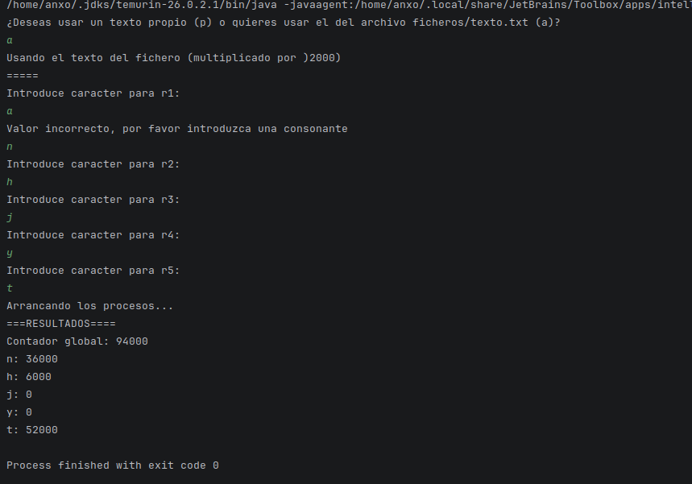
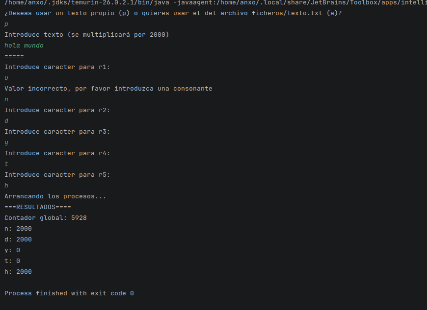

# Tarea 17 - Contador de caracteres

## Alumno

- Anxo Vázquez Lorenzo

## Asignatura

- PSP - 2DAM

## Estructura del proyecto

- `Main.java` -> Lanzador del programa

- `ficheros/` -> lugar del texto a recorrer

- `ContadorChar` -> Clase que sirve como contador tanto global como independiente (de cada carácter)

- `RecorrerTexto` -> Clase encargada de recorrer letra por letra el texto

## Clase `ContadorChar`

Esta clase contiene un `lock` a nivel de Objeto en su método `incrementar` que restringe su uso a los hilos que intenten acceder a esa sección del método **de la misma instancia**, es decir si dos hilos intentar incrementar el contador de la misma instancia los va a restringir (esperar a que uno termine para incrementar el otro), pero si dos hilos intentan usar ese método de **dos instancias distintas** no se bloquearán. En caso del contador global se restringirá el acceso a los 5 hilos.

```java
public class ContadorChar {
    private int contador = 0;
    private final Object lock = new Object();

    public void incrementar(){
        synchronized (lock) {
            this.contador += 1;
        }
    }

    public int getContador(){
        return this.contador;
    }
}

```

También se podría hacer un `synchronized` a nivel del método y funcionaría igual para este caso.

```java
//se elimina el objeto candado
synchronized public void incrementar(){
            this.contador += 1;
    } 
```

## Clase `RecorrerTexto`

Esta clase contiene un constructor y un método que recorre el texto carácter a caráter y aumenta el contador local.

````java
public class RecorrerTexto {
    public String texto;
    public char caracter;
    public ContadorChar contadorLocal = new ContadorChar();
    public RecorrerTexto(char c, String texto){
        this.texto = texto;
        this.caracter = c;
    }
    public void contarCaracter(ContadorChar cGlobal){
        for(int i = 0; i<this.texto.length();i++){
           if(this.texto.charAt(i) == this.caracter){
               cGlobal.incrementar();
               this.contadorLocal.incrementar();
           }
        }
    }
}
````

## Clase `Main`

Esta clase contiene el método `main` que actúa como lanzador del programa, adicionalmente también tiene 2 métodos extra, uno para leer el texto de un archivo y otro que valida que el usuario introduce una consonante.

Primero se le pide al usuario si quiere introducir él mismo un texto o quiere usar el del archivo `ficheros/texto.txt`:

````java
int numMultiplicacionesTexto = 2000;
String texto = "";
ContadorChar contadorGlobal = new ContadorChar();
Scanner sc = new Scanner(System.in);
        sc.useDelimiter("\n");

        System.out.println("¿Deseas usar un texto propio (p) o quieres usar el del archivo ficheros/texto.txt (a)?");
String opcion = sc.next();
        if (opcion.toLowerCase().compareTo("p") == 0){
        System.out.println("Introduce texto (se multiplicará por " + numMultiplicacionesTexto + ")");
texto = sc.next().repeat(numMultiplicacionesTexto);
        }else{ //asumo que quiere usar el de texto.txt
                System.out.println("Usando el texto del fichero (multiplicado por )" + numMultiplicacionesTexto + ")");
texto = devolverTexto(new File("./ficheros/texto.txt")).repeat(2000);
        }

                System.out.println("=====");
````

A continuación se le piden las consonantes al usuario y se crean los hilos:

````java
System.out.println("Introduce caracter para r1:");
RecorrerTexto r1 = new RecorrerTexto(validarConsonante(sc), texto);
Thread thread1 = new Thread(() -> r1.contarCaracter(contadorGlobal));

System.out.println("Introduce caracter para r2:");
RecorrerTexto r2 = new RecorrerTexto(validarConsonante(sc), texto);
Thread thread2 = new Thread(() -> r2.contarCaracter(contadorGlobal));

System.out.println("Introduce caracter para r3:");
RecorrerTexto r3 = new RecorrerTexto(validarConsonante(sc), texto);
Thread thread3 = new Thread(() -> r3.contarCaracter(contadorGlobal));

System.out.println("Introduce caracter para r4:");
RecorrerTexto r4 = new RecorrerTexto(validarConsonante(sc), texto);
Thread thread4 = new Thread(() -> r4.contarCaracter(contadorGlobal));

System.out.println("Introduce caracter para r5:");
RecorrerTexto r5 = new RecorrerTexto(validarConsonante(sc), texto);
Thread thread5 = new Thread(() -> r5.contarCaracter(contadorGlobal));

sc.close();
````

Ahora inicio los hilos y espero a que terminen:

````java
System.out.println("Arrancando los procesos...");
thread1.start();
thread2.start();
thread3.start();
thread4.start();
thread5.start();


try {
    thread1.join();
    thread2.join();
    thread3.join();
    thread4.join();
    thread5.join();

}catch (InterruptedException e){
    throw new RuntimeException(e);
}
````

Muestro los resultados:

```java
System.out.println("===RESULTADOS====");

System.out.println("Contador global: " + contadorGlobal.getContador());
System.out.println(r1.caracter + ": " + r1.contadorLocal.getContador());
System.out.println(r2.caracter + ": " + r2.contadorLocal.getContador());
System.out.println(r3.caracter + ": " + r3.contadorLocal.getContador());
System.out.println(r4.caracter + ": " + r4.contadorLocal.getContador());
System.out.println(r5.caracter + ": " + r5.contadorLocal.getContador());
```

## Ejecución

Inicio el programa indicando que lea del archivo:



### Ejecución sin `lock` o `synchronized`

Modifico `ContadorChar` de la siguiente forma:

```java
public class ContadorChar {
    private int contador = 0;
    private final Object lock = new Object();

    /*
    public void incrementar(){
        synchronized (lock) {
            this.contador += 1;
        }
    }
    */
    
     public void incrementar(){
         this.contador += 1;
     }

    public int getContador(){
        return this.contador;
    }
}
```

Vuelvo a ejecutar y se puede ver que el contador global es incorrecto porque los hilos chocan entre sí al intentar cambiar el contador al mismo tiempo.



## Problemas encontrados

### Validación de consonantes

Me dio problemas el scanner para cerrarlo en el método `validarConsonante` del `Main` para solucionarlo decidí que ese método recogiese y reutilizase el `scanner` del método `main`.

```java
private static char validarConsonante(Scanner sc){
        char[] vocales = {'a', 'e', 'i', 'o', 'u'};
        while(true) {
            String vocalUsuario = sc.next().toLowerCase();
            boolean esConsonante = true;
            if (vocalUsuario.length() != 1) {
                System.out.println("Valor incorrecto, por favor introduzca una consonante");
                //no hace falta indicar que esConsonante = false porque vuelve al principio del while y le pide otra letra
                continue;
            }
            for (char vocal : vocales) {
                if (vocal == vocalUsuario.charAt(0)) {
                    System.out.println("Valor incorrecto, por favor introduzca una consonante");
                    esConsonante = false;
                    break;
                }
            }
            if(esConsonante) {
                return vocalUsuario.charAt(0);
            }
        }
    }
```

### Problemas con mayúsculas y minúsculas

Tuve problemas con las mayúsculas y minúsculas de los textos ya que `"A" != "a"`, así que usé el método `toLowerCase()` de `String`.

## Bibliografía

- Geeksforgeeks - FileInputStream Java

  https://www.geeksforgeeks.org/java/java-fileinputstream-read-method-with-examples/

- Baeldung - synchronized

  https://www.baeldung.com/java-synchronized
